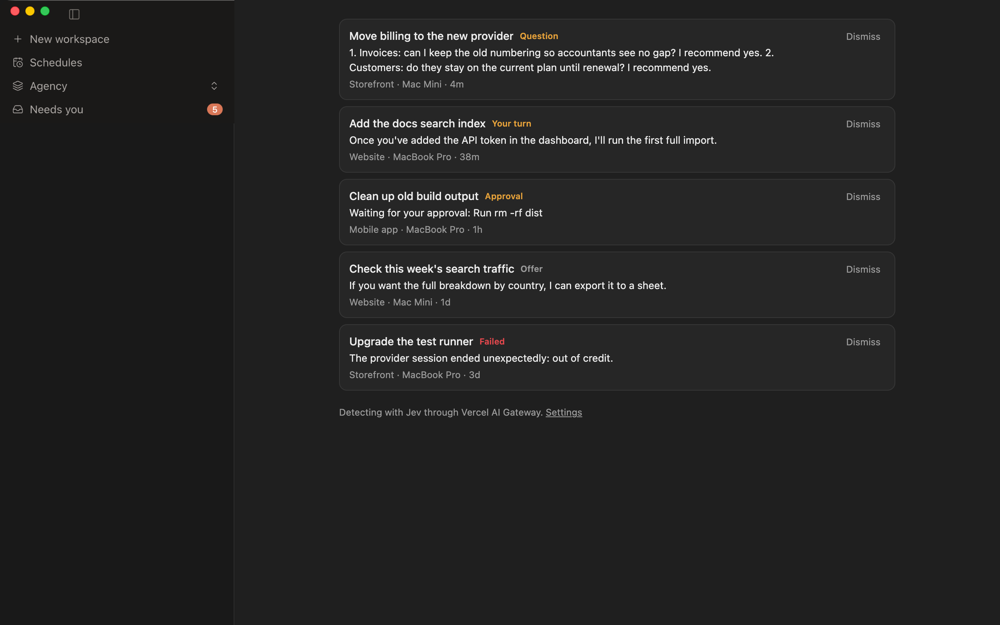

# Needs you for Paseo

A sidebar row showing how many of your [Paseo](https://paseo.sh) agents are waiting on you, and
a list of them across every connected host. It catches what Paseo's own status can't: an agent
that finished its turn and asked you something in plain text.



## What it lists

| Tag       | Means                                                     |
| --------- | --------------------------------------------------------- |
| Approval  | The agent is blocked on a permission or question prompt.  |
| Question  | Its last message asks you to answer or decide something.  |
| Your turn | Its last message asks you to do something first.          |
| Offer     | Its last message offers more work you could take up.      |
| Failed    | The agent stopped with an error.                          |

Press an entry to open the agent. On desktop and web its project also unfolds in the sidebar, and
with [Spaces](https://github.com/multiplehats/paseo-spaces) installed the sidebar switches to the
agent's Space. Nothing depends on Spaces being there.

An entry stays until you reply or press Dismiss, including across a daemon restart. A dismissed
agent comes back when it says something new, and dismissing on one device clears it on the others.

Agents started by another agent are left out, because their questions go to that agent. The
exception is a permission prompt, which blocks the agent whoever started it.

## Install

Requires Paseo 0.15 or later.

```sh
paseo plugin add git:multiplehats/paseo-needs-you
```

Plugins are off until you turn them on (`paseo daemon config set pluginsEnabled true`). The row
is added to the sidebar header; move it in Settings, Sidebar, Header.

**Install it on one host, ideally one that stays on.** It lists agents from every host the app is
connected to, and a second copy would add a second row. Model calls, dismissals and the key live
on the host you install it on, so those stop while that host is off.

## How agents are detected

With no setup, text rules read each idle agent's last message. They ignore code, links, quotes
and headings, then look for a question mark or a request such as "let me know" or "once you've",
in English and Dutch. They lean towards listing too much, since a wrong entry is one Dismiss and a
missed question is the thing this plugin is for.

For better accuracy, open Settings, Needs you, and pick a provider for
[Jev](https://docs.typesafe.ai), TypeSafe's decision model:

| Provider          | Environment variable |
| ----------------- | -------------------- |
| OpenRouter        | `OPENROUTER_API_KEY` |
| Vercel AI Gateway | `AI_GATEWAY_API_KEY` |
| TypeSafe          | `TYPESAFE_API_KEY`   |

Paste the key in that screen. The environment variable is a fallback for daemons you start
yourself: a daemon started by the desktop app does not see variables exported in your shell.

Jev costs about $0.042 per million input tokens, so a long message costs around $0.0001 to judge.
Each message is judged once. If a call fails, the rules take over, the list says why, and it tries
again five minutes later.

**Privacy.** With a provider on, each idle agent's last message goes to that provider and on
to TypeSafe. With text rules, nothing leaves your hosts. Message text is never
written to the plugin log.

A saved key is stored in `~/.paseo/plugin-secrets/needs-you.json`, readable only by you, and no
call returns it to the app.

## Development

```sh
npm install
npm run check                       # typecheck, lint and tests
paseo plugin add "$PWD"             # run it from this checkout
paseo plugin reload needs-you       # after a change
```

Every word sent to the model is in `shared/jev.ts`, and the text rules are in `shared/verdict.ts`.

Unfolding presses the project's own sidebar row, found by its test ID, because Paseo has no API
for it. The row carries `data-paseo-unfolding` meanwhile, so another plugin doing the same doesn't
press it closed again.

## License

[MIT](LICENSE)
